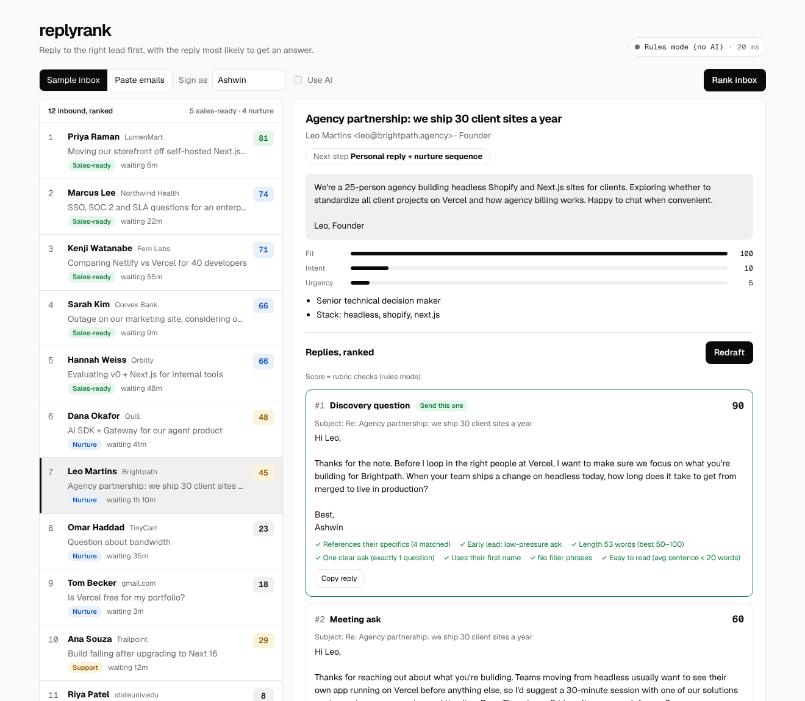

# replyrank

**Reply to the right lead first, with the reply most likely to get an answer.**

replyrank is a small tool for inbound sales development. Paste in a morning's inbound email, or use the sample inbox, and it will:

1. **Rank the queue.** Each email gets a fit, intent and urgency score, a category (sales-ready, nurture, support, not-a-lead, spam), the reasons behind it, and who should own the reply. Spam and job requests never reach the top, and leads that have waited longer get a small speed-to-lead boost.
2. **Draft three replies per lead**, each with a different strategy: a meeting ask, a discovery question, or a proof-led reply.
3. **Rank those replies.** A transparent rubric checks specifics from their email, length, a single clear ask, filler phrases, and whether the ask fits the lead's intent. A hot lead should get a concrete meeting time; a curious one should get a low-pressure question. In AI mode, a separate model call judges reply likelihood, so the writer never grades its own work.



Built with **Next.js 16**, the **AI SDK 7** and **Vercel AI Gateway**, and it runs on the free Hobby plan.

## Deploy (about 1 minute, free)

[](https://vercel.com/new/clone?repository-url=https://github.com/tiwaker9404/replyrank&project-name=replyrank)

No environment variables are needed. On Vercel, AI Gateway authenticates with the project's OIDC token automatically and uses the Hobby plan's free monthly Gateway credit. If the Gateway is unavailable or the rate limit is hit, the app falls back to rules mode instead of failing.

## Run locally

```bash
npm install
npm run dev                         # rules mode, no keys needed
AI_GATEWAY_API_KEY=... npm run dev  # AI mode
```

| Variable | Default | Purpose |
| --- | --- | --- |
| `REPLYRANK_MODEL` | `deepseek/deepseek-v4.1-flash-1017` | Primary Gateway model (any `provider/model` id) |
| `REPLYRANK_FALLBACK_MODELS` | `inception/mercury-3,tencent/hy4-flash` | Gateway fallbacks, tried in order |
| `REPLYRANK_MODE` | (unset) | Set to `rules` to force rules-only mode |
| `REPLYRANK_AI_CALLS_PER_10MIN` | `20` | Per-IP AI call limit that protects the free credit |

## How the scoring works

- **Lead score** = 40% intent + 35% fit + 25% urgency, plus up to 8 points for time waiting. In AI mode, the model's scores are blended 60/40 with the rules scores. The rules' hard gates for spam and not-a-lead always win, because they are cheap and precise.
- **Draft score** = rubric (0–100). In AI mode it is 50% rubric and 50% judge.
- Everything shown in the UI, including reasons, bars and checks, is the actual input to the score. Nothing is hidden.

## Tests and eval

```bash
npm test       # parser, gates, rubric, and the AI path against the AI SDK mock model
npm run eval   # ranks a hand-labelled 12-email inbox and reports ordering accuracy
```

Current rules-mode eval: **98.1% pairwise ordering accuracy, 4/4 tier-1 leads in the top 4, 12/12 categories correct**. A caveat: the sample inbox and its labels were written by the author, and the rules were tuned against it. Treat the result as a regression check, not proof of accuracy on real inbound. The next step would be a held-out set of real, anonymized inbound. CI runs the tests, the eval (it fails below 85% pairwise accuracy) and the build on every push.

## Project layout

```
app/page.tsx          UI (queue, lead detail, ranked drafts)
app/api/rank          POST leads -> ranked leads
app/api/drafts        POST lead  -> 3 ranked drafts
lib/rules.ts          lead scoring, draft rubric, template drafts (no AI)
lib/ai.ts             AI Gateway calls: triage, drafting, separate judge
lib/rank.ts           blending + fallbacks
lib/samples.ts        sample inbox with ground-truth labels
scripts/eval.ts       offline eval
```

All sample companies and people are fictional.

MIT license. Built by [Ashwin Tiwari](https://github.com/tiwaker9404).
